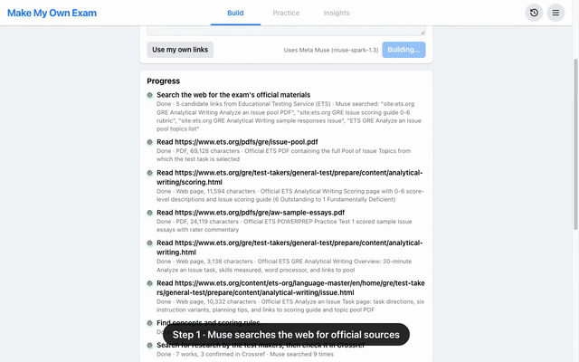

# Make My Own Exam

Name any exam in one sentence. Meta Muse searches the web for the test maker's official materials and builds a knowledge base from them: the questions, the scoring rules, and research on the exam. Then it serves questions and scores your answers on that exam's own rubric.

- Live: https://make-my-own-exam.pages.dev
- Demo video (88 s): [demo/make-my-own-exam-demo.mp4](demo/make-my-own-exam-demo.mp4)

[](demo/make-my-own-exam-demo.mp4)

## Exams it has built

Each of these was built live from the one sentence shown, with no links given. Every source in the "Found and read" column came from Muse's own web search.

| Exam (what was typed) | Found and read | Result |
|---|---|---|
| "GRE Analytical Writing, the Analyze an Issue essay…" | ETS topic pool PDF, official scoring guide page, three PDFs of scored sample essays | 162 essay prompts, official 0–6 scale, 4 dimensions |
| "AP United States History free-response questions…" | College Board 2024–2026 free-response and scoring-guideline PDFs, DBQ samples with commentary | 53 short-answer and essay questions, 0–7 rubric from the guidelines |
| "IELTS Academic Writing Task 2 essays…" | IELTS writing band descriptors, key assessment criteria, examiner-commented sample answers | 18 essay prompts, official 0–9 band scale |
| "US citizenship naturalization civics test…" | USCIS 100-question PDF, Policy Manual scoring rules, test scoring guidelines, 2025 test update | 212 short-answer questions, each with its official answer |

The saved results are in `public/data/examples/` and `public/data/example-gre.json`. Rebuild one with `node tools/try-exam.mjs "<sentence>" out.json`. Search results vary between runs, so counts vary a little too.

## How it works

### Step 1: build the knowledge base

1. **Find the sources.** Muse's `web_search` tool (Meta Model API, Responses endpoint) looks for the official question pool, the scoring guide, scored samples and the overview. Every link is opened, and a link that fails is shown as skipped. A page with the same content as one already read is skipped too.
2. **Fill the gaps.** If the scoring guide, the samples or the question pool are still missing, the app follows links on the official pages, for up to two rounds. Same-site PDFs whose names match what is missing are opened directly, and Muse chooses among the other links. If something is still missing after that, Muse searches again for just that item.
3. **Questions.** Every question that appears in the sources is copied exactly, together with its official answer where one is published. Each one is tagged with a concept (a subject area the questions are about). The server drops any question whose opening words do not occur in the source text, so an invented question is removed.
4. **Scoring rules.** If the sources include an official scoring guide, its levels are restated in our own words and marked "From the official guide". Otherwise a rubric is derived and marked as such.
5. **Research behind the exam.** Muse searches the web for papers and reports by the test makers, or on how the exam is designed and scored. Each one is then looked up in [Crossref](https://www.crossref.org/). Only works found there are marked "Confirmed" with a DOI link.

PDFs and pages are parsed in the browser (pdf.js, DOMParser). The server only relays the bytes, which keeps it under Workers CPU limits.

### Step 2: practice

- Pick a question, or use **Recommend for me**. **New question like this** writes a fresh question in the same style, and it is labeled "Written by the model".
- Answer against the exam's time limit. Muse scores the answer on the knowledge base's own rubric, checking it against the official answer when one exists. Multiple-choice questions with an answer key are checked locally.
- The result has a score on the exam's scale, a score per rubric dimension, a check on whether the answer does what this question asks, and 2–3 revisions. A quoted phrase is kept only if it really appears in your answer.
- **Insights** never claims to predict your exact question. It shows where the pool's weight sits, and it ranks what to practice next by concept frequency and your lowest scores.

## Three ways to run the model

| | Collect and build | Grade |
|---|---|---|
| **Meta Muse (default)** | Server key, `muse-spark-1.3`, web search included | Same |
| **Your own API key** | Settings: your own Muse key, or any OpenAI-compatible base URL, key and model | Same |
| **Your own agent, over MCP** | Prompt 1 (below) | Prompt 2 (below) |

With no key, the site's server key is capped at `DAILY_LIMIT` calls per IP per day. Keys you enter stay in your browser and are sent only with your own requests.

### Your own agent: two prompts

The app gives both prompts with one click. **Or collect it with your own agent** on the Build page has prompt 1, and **Grade with my agent** under an answer has prompt 2. Each one starts by installing two MCP servers:

```bash
claude mcp add chrome-devtools -- npx -y chrome-devtools-mcp@latest --channel=canary
```

```bash
claude mcp add --transport http make-my-own-exam https://make-my-own-exam.pages.dev/mcp
```

Chrome DevTools MCP drives Chrome Canary, so the agent browses in a separate browser from your everyday one. The second server is this site's MCP endpoint (`functions/mcp.js`, streamable HTTP). Its tools:

| Tool | What it does |
|---|---|
| `save_exam` | Saves a knowledge base the agent collected (its description has the JSON shape). Returns an `open_url` that opens it in the app |
| `get_exam` | Returns the rubric, the concepts and the question ids |
| `get_grading_guide` | Returns the question, the rubric, the rater instructions and the grade's JSON shape, so the agent grades with its own model |
| `save_grade` | Saves that grade. Quotes not found in the answer are dropped. Returns an `open_url` showing the result |
| `grade_with_muse` | Lets Muse grade it on the server instead |

1. **Collect:** the agent opens the official pages in Canary, copies the questions, restates the rubric, lists research it actually opened, calls `save_exam`, and hands back a link. Tested with Claude Code (Sonnet 5.5) on the USCIS civics test: it saved 100 questions with official answers from uscis.gov.
2. **Grade:** the agent calls `get_grading_guide`, grades with its own model, and calls `save_grade`. Tested on a GRE essay: Claude Sonnet 5.5 gave 5/6 with a quote on every dimension, and Muse gave the same essay 5/6.

## Calibration

`node tools/calibrate.mjs` grades the 12 scored sample essays from two ETS GRE practice tests, using the rubric the app built, and compares the results with the official scores. The samples are copy-restricted, so they are not in this repository. Only the agreement numbers are published.

| grader | essays | exact | within 1 | mean abs. error |
|---|---|---|---|---|
| fixed GRE rubric, first prompt | 12 | 3 | 9 | 1.08 |
| fixed GRE rubric, current prompt | 12 | 5 | 10 | 0.75 |
| rubric the app built from the ETS sources | 12 | 6 | 9 | 0.75 |

The grader runs about one level low on the strongest essays. These are in-sample numbers: the prompt was adjusted against the same 12 essays. Repeat runs also vary by a point on some essays.

## Limits

- An exam has one rubric. AP U.S. History scores its short answers, DBQ and long essay differently, but here they share one 0–7 rubric.
- Sources that need a login, or files over 15 MB, are skipped.
- Muse's web search finds different pages on different runs. A build that misses the question pool says so, and the agent prompt or "Use my own links" are the fallbacks.

## Run it

```bash
npm install
npm test
npm run deploy
```

Set the server key with `npx wrangler pages secret put MODEL_API_KEY --project-name make-my-own-exam`.

The demo video is scripted. `node demo/record.mjs` drives the live site in Chrome, adds the title card, captions and zooms in the page, fast-forwards the live build, and muxes narration from `demo/audio/` (`demo/tts-elevenlabs.mjs` makes the narration).

## Notes

- Questions are quoted from public sources for personal study. Check each source's terms before sharing what you build.
- Exam names belong to their owners: GRE® and TOEFL® (ETS), AP® (College Board), IELTS (British Council, IDP and Cambridge). This project is not affiliated with or endorsed by any test maker, and it uses no Meta logos.
- Scores are practice estimates.
